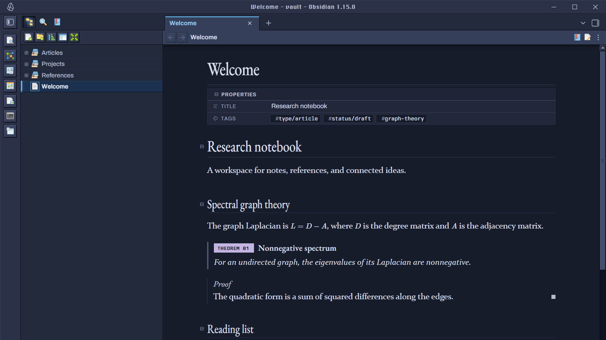
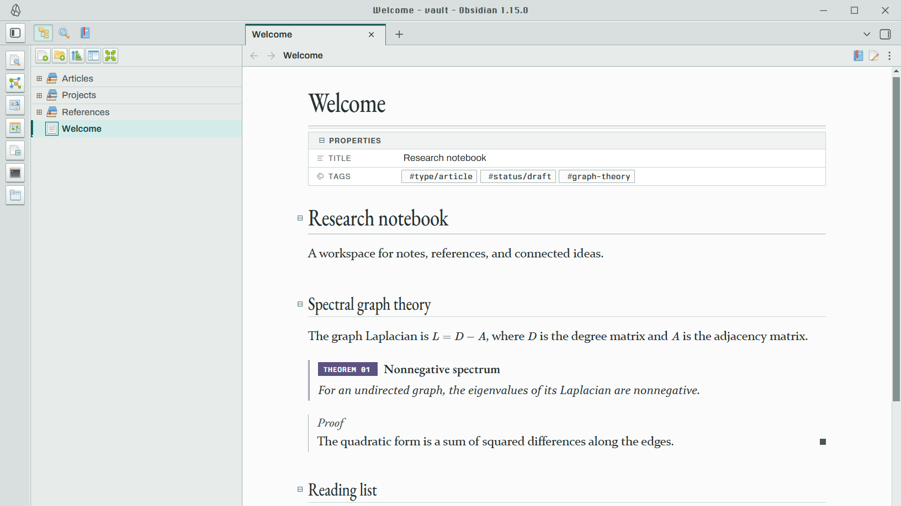

# Plectics Alto Icons

Plectics Alto Icons is a version of the Plectics Alto Obsidian theme with colour icons, light and dark modes, serif typography, and a compact interface inspired by classic desktop software. It includes custom styles for mathematical callouts, tables, tags, and note properties.

[Plectics Alto](https://github.com/1800MIRACLE/obsidian.themes.plectics-alto) provides the same theme with line icons. [Typed Notes](https://github.com/1800MIRACLE/obsidian.plugin.typed-notes) is the optional companion plugin for tag families and display titles.

## Screenshots





## Features

- Light mode and a blue-grey **Blue-steel** dark mode, with an optional Metal finish.
- Serif reading text, condensed Garamond titles, compact menus, file lists and tabs.
- Mathematical callouts with shared theorem numbering and an end-of-proof mark.
- Additional callouts for hypotheses, equations, figures, tables, references and wiki-style notes.
- Page layouts selected through the note's `cssclasses` property.
- Tag families based on prefixes such as `type/`, `status/`, `author/` and `meta/`.
- Six tag styles and six Properties layouts through the optional Style Settings plugin.
- Styles for tables, code, Canvas and supported community plugins.

## Download and installation

Requires **Obsidian 1.6.0 or later**. No build tools or community plugins are needed to use the theme.

**[Download Plectics Alto Icons (ZIP)](downloads/plectics-alto-icons.zip?raw=true)**

The archive contains a folder named **`Plectics Alto Icons`**. Extract it, then drag or copy that folder into your vault's `.obsidian/themes/` folder.

### Windows

1. Download the ZIP. In File Explorer, right-click it and choose **Extract All**.
2. Open your vault folder. If you cannot see `.obsidian`, enable **Hidden items** in File Explorer's **View** menu.
3. Open `.obsidian/themes`; create the `themes` folder if necessary.
4. Drag the extracted `Plectics Alto Icons` folder into `themes`.

### macOS

1. Download the ZIP and double-click it in Finder to extract it.
2. Open your vault folder. Press **Command + Shift + .** to show hidden folders.
3. Open `.obsidian/themes`; create the `themes` folder if necessary.
4. Drag the extracted `Plectics Alto Icons` folder into `themes`.

### Linux

1. Download the ZIP and extract it with your archive manager.
2. Open your vault folder. In most file managers, **Ctrl + H** shows hidden folders.
3. Open `.obsidian/themes`; create the `themes` folder if necessary.
4. Copy the extracted `Plectics Alto Icons` folder into `themes`.

On every platform, the result must contain these files directly inside the theme folder:

```text
Your vault/
└── .obsidian/
    └── themes/
        └── Plectics Alto Icons/
            ├── manifest.json
            └── theme.css
```

Open Obsidian, then select **Plectics Alto Icons** under **Settings → Appearance → Themes**. Restart Obsidian if it does not appear. Choose light or dark mode in Appearance.

These paths assume Obsidian's default configuration folder, `.obsidian`. If your vault uses a different configuration folder, use that folder instead. Installation is per vault.

### Alternative: GitHub's Download ZIP

The green **Code → Download ZIP** button downloads the whole repository, including documentation and source files. Extract it, create a folder named `Plectics Alto Icons`, and copy the repository's root `theme.css` and `manifest.json` into that folder. Place it in `.obsidian/themes/` as above.

Do not leave an extra repository folder between `Plectics Alto Icons` and those two files. The installation ZIP linked above already has the correct folder structure.

### Updating and removing

To update a manual installation, extract the new ZIP and replace the installed theme files, then reload Obsidian. Keep personal CSS changes in a separate Obsidian CSS snippet so an update does not overwrite them.

To remove the theme, switch to another theme in Appearance and remove its folder from `.obsidian/themes/`. This does not change your notes.

## Writing notes

### Mathematical callouts

Use standard Obsidian callout syntax:

```markdown
> [!definition] Bounded sequence
> A sequence is bounded if there is an $M$ such that $|a_n| \le M$ for every $n$.

> [!theorem] Monotone convergence
> Every bounded monotone sequence of real numbers converges.

> [!pf]
> An increasing bounded sequence converges to the supremum of its terms.
```

Definitions, theorems, lemmas, propositions, corollaries, claims, conjectures and related formal callouts share a counter within a note. Proofs and solutions are unnumbered and end with ∎. Hypotheses, assumptions, equations, figures, tables and algorithms use separate counters.

| Syntax | Use |
|---|---|
| `[!theorem] Name` | A numbered theorem with a title |
| `[!thm]` | A numbered theorem without a title |
| `[!theorem\|star] Name` | An unnumbered theorem |
| `[!definition]`, `[!lemma]`, `[!corollary]` | Other formal callouts |
| `[!pf]`, `[!sol]` | Proof or solution |
| `[!hypothesis]`, `[!assumption]` | Numbered research premises |
| `[!equation]`, `[!figure]`, `[!table]` | Numbered supporting material |
| `[!references]`, `[!seealso]`, `[!infobox]` | Reference lists and supplementary information |

Short aliases such as `thm` and `pf` hide the title text; use the long name when you want to supply a title.

Numbering is generated by CSS. **Live Preview only renders part of a long note, so its numbers may be incomplete or change while scrolling.** Use Reading view to inspect the full sequence. These visual counters do not create persistent equation identifiers or cross-references.

### Page types and tags

```yaml
---
tags:
  - type/article
  - status/draft
  - information-theory
cssclasses:
  - type-article
---
```

The tag assigns a tag family; `cssclasses` selects the page layout. Adding `type/article` alone does not set `type-article`.

| CSS class | Treatment |
|---|---|
| `type-article` | Article label and ruled section headings |
| `type-paper` | Reading-note layout and citation styling |
| `type-person`, `type-group` | Biography or organisation layout |
| `type-index` | Lists arranged in columns |
| `type-glossary` | Headword styling for bold terms in lists |
| `type-timeline` | Timeline styling for lists |
| `type-note` | Quieter working-note title |
| `type-memo` | Memorandum layout |
| `type-proof` | Centred title and closing proof mark |
| `type-project`, `type-event`, `type-dataset` | Type labels; wider tables and monospaced numbers for datasets |

## Optional plugins and settings

The theme works on its own. Two optional plugins expose additional features:

- **[Typed Notes](https://github.com/1800MIRACLE/obsidian.plugin.typed-notes)** adds the family information needed to colour tags in Properties and to split tag paths for certain tag styles. It also supplies editable display titles from a frontmatter property. Without it, ordinary inline tags still receive the theme's built-in family colours, but Properties chips do not receive those family distinctions.
- **Style Settings** exposes the theme's fonts, interface options, tag styles, Properties layouts and Canvas settings. Install it from Obsidian's community plugin browser, then open its **Plectics Alto** section.

| Setting | Default | Other choices |
|---|---|---|
| Reading font | Constantia, with fallbacks | Georgia, EB Garamond, IBM Plex and other installed fonts |
| Title font | Alto Garamond Condensed | EB Garamond or installed Apple Garamond |
| Dark palette | Blue-steel | Metal finish can be enabled |
| Properties layout | Panel | Ledger, Strip, Margin, LCD, Tucked |
| Tag style | Plectics | Path, Obsidian coloured, Obsidian half, Label, Plain |
| Obsidian accent colour | Off | Enable to follow Obsidian's accent |

No Style Settings installation is needed for the defaults. Existing CSS snippets and other plugins can override theme styling.

## Fonts

Alto Garamond Condensed, Archivo and Nimbus Sans are embedded in the theme CSS. You do not need to install them separately.

Other names in the font settings refer to locally installed fonts. Constantia is the first choice for reading text; unavailable fonts fall back to the next face in the stack. Text may therefore differ between Windows, macOS and Linux. Commercial fonts such as Apple Garamond and Berkeley Mono are not included.

## Colour icons

Farm-Fresh colour icons are embedded in the CSS and enabled by default for files and tabs. No icon download or icon plugin is required.

Style Settings can turn them off, extend their scope to **Everywhere**, or control interaction with Iconize. By default, an icon assigned by Iconize is kept.

The Farm-Fresh Web Icons are by **FatCow Web Hosting**, licensed under **CC BY 3.0 US**. Some icons are compositions made from those assets; attribution and licence texts accompany the theme.

## Documentation and source

The shared theme source and guides are maintained in [Plectics Alto](https://github.com/1800MIRACLE/obsidian.themes.plectics-alto):

- [Usage guide](https://github.com/1800MIRACLE/obsidian.themes.plectics-alto/blob/main/docs/GUIDE.md).
- [All settings and defaults](https://github.com/1800MIRACLE/obsidian.themes.plectics-alto/blob/main/docs/SETTINGS.md).
- [Font licences](https://github.com/1800MIRACLE/obsidian.themes.plectics-alto/blob/main/docs/FONT-LICENCES.md).
- [Building from source](https://github.com/1800MIRACLE/obsidian.themes.plectics-alto/blob/main/docs/DEVELOPMENT.md).

This repository contains the installable colour-icon variant. End users do not need to build it.

## Compatibility and reporting issues

The manifest declares Obsidian 1.6.0 as the minimum version. This is not a claim that every operating system, mobile device or community plugin has been tested. Third-party plugins can introduce layouts the theme does not cover.

When reporting a problem in this repository's **Issues**, include the Obsidian version, operating system, light/dark mode, relevant Style Settings choices, and a small note that reproduces it. A screenshot is useful for a visual issue.

## Licence

The theme code is licensed under **GPL-3.0**; see [LICENSE](LICENSE). Embedded fonts and icons retain their own licences. See [NOTICE.md](NOTICE.md) for attribution and asset terms.


To rebuild the installable ZIP from the checked-out files, run `python package.py` (Python 3, standard library only). The script verifies every packaged file against its source.
